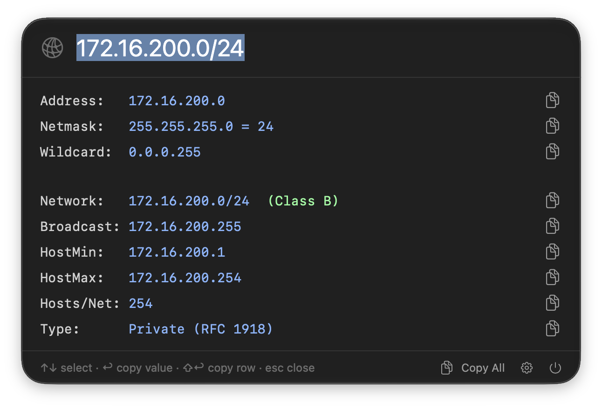

# IP Calc

A fast, offline IPv4 and IPv6 subnet calculator for macOS, modelled on
[jodies.de/ipcalc](https://jodies.de/ipcalc). Press <kbd>⌃⌥Space</kbd> anywhere, type an address or
network, and the result appears as you type, in a Spotlight-style panel. Press <kbd>↩</kbd> to copy a
value and get back to where you were, ready to paste.

<p align="center"></p>

- Network, broadcast, host range, netmask, wildcard, host count and address type for any IPv4 or IPv6 network
- Binary view with netmask and address class highlighted, like the original ipcalc
- Subnetting, supernetting and splitting address ranges into CIDR blocks
- Copy any value, a whole row, or everything with the keyboard or the mouse
- Works completely offline; no network access, no tracking

Requires macOS 26 (Tahoe) or later.

## Installation

With [Homebrew](https://brew.sh):

```sh
brew install --cask backbonesk/tap/ip-calc
```

Or download the zip from the [latest release](https://github.com/backbonesk/ipcalc-macos/releases/latest),
unzip it and move **IP Calc** to `/Applications`.

Start IP Calc once; from then on, <kbd>⌃⌥Space</kbd> opens it. Turn on **Launch at login** in Settings
to keep it available after a restart.

## Usage

| Key                       | Action                                                  |
|---------------------------|---------------------------------------------------------|
| <kbd>⌃⌥Space</kbd>        | Show / hide the panel (configurable in Settings)        |
| <kbd>↑</kbd> <kbd>↓</kbd> | Select a row (the cursor stays in the input)            |
| <kbd>↩</kbd>              | Copy the selected value and close the panel             |
| <kbd>⇧↩</kbd>             | Copy the whole selected row and close the panel         |
| <kbd>⇧⌘C</kbd>            | Copy everything                                         |
| <kbd>⌘,</kbd>             | Settings                                                |
| <kbd>⌘Q</kbd>             | Quit IP Calc (also the power icon in the panel footer)  |
| <kbd>Esc</kbd>            | Hide the panel                                          |
| Right-click a row         | Copy Value / Copy Row / Copy Binary                     |

Every copy action also closes the panel and returns you to the app you were in, so <kbd>⌘V</kbd>
pastes straight away. To copy several values in a row, set **After copying** to *Keep panel open* in
Settings.

Like Spotlight, the panel hides when you click elsewhere. When it opens again, it shows the last
result with the input selected: read it again, or just start typing to replace it. Drag the panel
from anywhere except the input text to move it; it reopens where you left it.

IP Calc has no Dock icon. It lives in the menu bar and keeps running in the background. If you hide
the menu bar icon, open IP Calc from Finder or press <kbd>⌘,</kbd> in the panel to reach Settings.

### Settings

- **Shortcut** to open the panel
- **After copying**: close the panel (default) or keep it open
- **Launch at login** and **Show menu bar icon**
- **Appearance**: text size, label brightness, binary column and notes on or off, and colors for
  values, netmask bits, and class bits and notes. Changes show in the panel as you make them.

### Spotlight

IP Calc also adds a Spotlight action: press <kbd>⌘Space</kbd>, type **IP**, press <kbd>Tab</kbd>, enter
the address and press <kbd>↩</kbd> to open the panel with that input. If the action doesn't show up,
start IP Calc once, or log out and back in.

## Input formats

| Input                                         | Meaning                                    |
|-----------------------------------------------|--------------------------------------------|
| `172.16.0.0/12`, `172.16.0.0 12`              | CIDR prefix                                |
| `172.16.0.0/255.240.0.0`, `… 255.240.0.0`     | Dotted netmask                             |
| `172.16.0.0/0.15.255.255`                     | Wildcard (Cisco-style) mask                |
| `172.16/12`                                   | Short form, missing octets are 0           |
| `10.1.2.3`                                    | No mask, defaults to /24 like ipcalc       |
| `192.168.0.0/24 /26`, `… -> 26`               | Split into subnets                         |
| `172.16.0.0/12 /8`                            | Supernet                                   |
| `10.0.0.5 - 10.0.0.70`                        | Split a range into CIDR networks           |
| `2001:db8::1/64`, `2001:db8::1 64`            | IPv6 network (any RFC 4291 text form)      |
| `fe80::1`                                     | No prefix, defaults to /64                 |
| `2001:db8::/48 /64`                           | IPv6 subnets                               |
| `2001:db8::1 - 2001:db8::ff`                  | IPv6 range                                 |

The **Type** row (*Private (RFC 1918)*, *Loopback*, *CGNAT*, *Documentation*, *Public*, …) comes from
the IANA special-purpose address registries. IPv4 /31 networks are treated as RFC 3021
point-to-point links and /32 as host routes.

IPv6 results show the canonical (RFC 5952) and expanded address, netmask, first and last address,
the number of addresses, and the `ip6.arpa` reverse zone. There is no binary column for IPv6;
128 bits don't fit on one line.

## Feedback and contributing

Found a bug or missing a feature? Please [open an issue](https://github.com/backbonesk/ipcalc-macos/issues).
Pull requests are welcome too; see [CONTRIBUTING.md](CONTRIBUTING.md) for how to build and test the app.

## License

[MIT](LICENSE) © 2026 BACKBONE, s.r.o.
